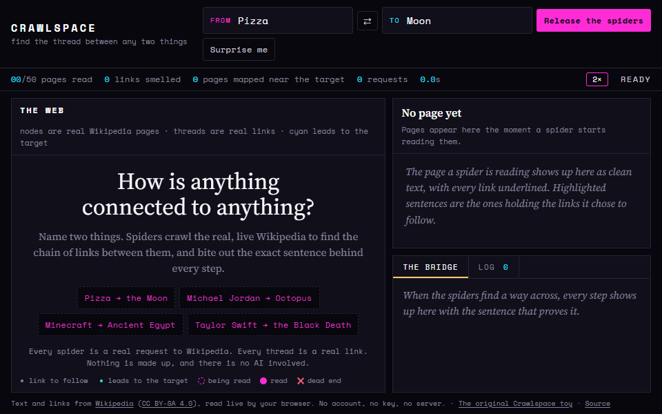

# Crawlspace

**How is anything connected to anything?** Name two things. Spiders crawl live Wikipedia to find the chain of links between them, and bite out the exact sentence behind every step.

**[Try it →](https://sohail000.github.io/CrawlSpace/)** No install, no account, no API key, no AI.

> **Pizza → Ancient Rome → Names of the days of the week → Moon**
>
> - *Pizza:* "Records of pizza-like foods can be found throughout ancient history from **Ancient Rome** to the Middle Ages."
> - *Ancient Rome:* "Romans **named week days** after celestial bodies from at least the 1st century AD."
> - *Names of the days of the week:* "… Saturn, Jupiter, Mars, Sun, Venus, Mercury, and the **Moon** …"

A few more the spiders found:

- **Minecraft → Emerald → Ancient Egypt.** "Emeralds in antiquity were mined in Ancient Egypt …"
- **Michael Jordan → Extraterrestrial life → Symmetry in biology → Octopus.** "The octopus, however, has bilateral symmetry, despite its eight arms."
- **Pizza → Italian cuisine → São Paulo → Introduced species → *Steatoda nobilis*.** "… the introduction of Steatoda nobilis (Noble false widow) worldwide through banana shipments."

Every hunt has its own link, like [`#Pizza/Moon`](https://sohail000.github.io/CrawlSpace/#Pizza/Moon). Anyone who opens it watches the spiders hunt it live.

## Everything on screen is real

| On screen | What is actually happening |
|---|---|
| A hunter walks a thread | It is fetching that Wikipedia page right now. The timer is the real wait. |
| Underlined words in the reading pane | Every article link on the page the hunter just read. |
| A bite (highlighted sentence) | A sentence that holds a link the hunter chose to follow. |
| Feelers fanning toward the target | One request asking Wikipedia "which of these 48 links point at the target?" Each cyan pulse is a yes. |
| Cyan dots around the target | Real pages the sentinel learned are 1, 2 or 3 links from the target, from Wikipedia's "What links here". |
| The gold thread | The chain that was found, spun hop by hop by the orb-weaver. |

## How the spiders decide (no AI)

- **Scent.** The target gives off a scent: the words in its title, opening paragraph, categories and aliases, and in the titles of pages that link to it. Every link a hunter sees is scored by how strongly its title and sentence smell of it.
- **Sniffing.** After reading a page, a hunter asks Wikipedia in a single request which of its 48 most promising links point straight at the target.
- **The sentinel's map.** A crab spider waits on the target and maps up to three rings of pages around it, using batched "What links here" requests. A hunter that touches the map knows how close it is.
- **Best-first search.** Links are followed in order of hops taken plus estimated hops to go.
- **Pulled taut.** Once a chain is found, every page read so far is checked for a shorter one.

## Polite by design

Crawlspace runs entirely in your browser against Wikipedia's public API (CORS, no key). It keeps to at most 3 requests at a time and 120 a minute, under Wikimedia's published limits. If Wikipedia asks it to slow down, the spiders visibly rest. A typical hunt uses 10 to 40 requests.

## Run it yourself

Download the folder and open `index.html` in a browser. There is no build step and nothing to install.

To host it, use GitHub Pages: **Settings → Pages → Deploy from a branch → `main`, `/ (root)`**. Any other static host works too.

## Files

- `index.html`, `style.css`: the page
- `js/wiki.js`: Wikipedia API calls, the polite request governor, and HTML to prose with link positions
- `js/text.js`: scent, sentences and quotable receipts
- `js/hunt.js`: the hunt (hunters, sentinel, search, receipts)
- `js/web.js`: the live map
- `js/specimen.js`: the reading pane where bites happen
- `js/spider.js`: the procedural spider (eight IK legs, alternating gait)
- `js/app.js`: controls, share links and the address bar
- `Crawlspace.html`: the original toy, with spiders that crawl and bite any page (also works as a bookmarklet)

## Credits

Text and links come from [Wikipedia](https://en.wikipedia.org/) under [CC BY-SA 4.0](https://creativecommons.org/licenses/by-sa/4.0/). Each quote links back to its article. The code is MIT licensed.
