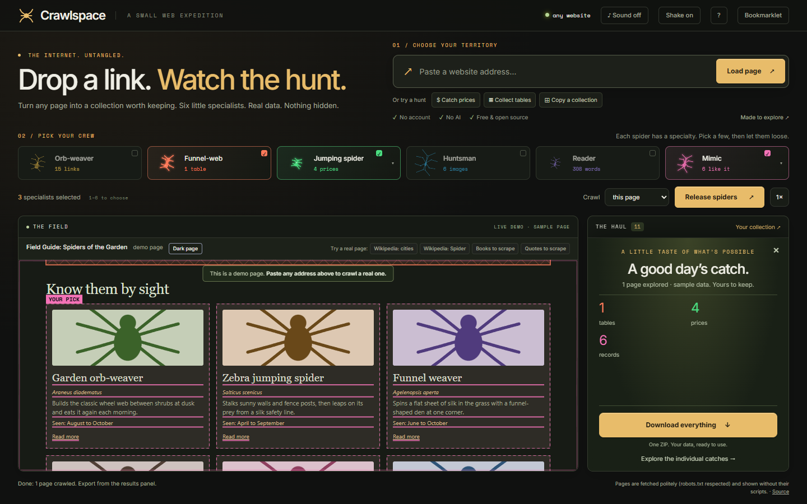

# Crawlspace

**Watch spiders crawl any web page.** Paste a web address and the page appears centre stage. Spiders, each with one job, crawl it in front of you and catch its links, tables, patterns, images and text, ready to export. Or click one thing on the page, and the Mimic catches everything like it.

**[Try it →](https://sohail000.github.io/CrawlSpace/)**



## The spiders

| Spider | Catches | How it moves |
|---|---|---|
| **Orb-weaver** | Every link, sorted into on-site, elsewhere, email/phone and files. Can crawl the whole site and check for broken links. | Walks link to link, anchoring silk at each one |
| **Funnel-web** | Every data table as clean rows: CSV, or straight into Excel | Traces the table's edge, wraps it in silk, sends the bundle to the results |
| **Jumping spider** | Emails, phone numbers, prices, dates, web addresses, or your own pattern | Leaps from match to match and bites each one |
| **Huntsman** | Every image, with its size and whether it has alt text | Sprints to each image and tags it |
| **Reader** | The main text without menus or ads, as Markdown | Walks down the margin of each block it keeps |
| **Mimic** | Whatever you point at. Click one product's name and get every product on the page as a table: name, price, link, image | Carries the outline of your pick from record to record, underlining each field it copies |

Each catch shows up in the results panel the moment the spider makes it, and the page's outline shakes like a web. Click any result to see it on the page.

## Teach the Mimic

Press **Teach it**, then click one thing that repeats on the page: a product name, a price, a row of a table. The Mimic works out what that thing belongs to (the product card, the table row) and catches every one like it, with all the fields they share as columns. Columns are named after the page's own labels where it has them (a table's header, a "video-title"). Drop any column you don't need.

Crawl the site afterwards and the Mimic catches the same records on every page it visits, so 5 pages of a shop listing become one table.

## Site map

Crawl a site (“this site, up to 25 pages”) and the Orb-weaver draws what it found as an orb web: the start page is the hub, each crawled page is a knot, and each link that led there is a thread. Pages it found but didn't crawl ring the rim; broken pages are snapped threads. Hover a knot for its details, click it to put that page on stage.

## Pages that need JavaScript: the bookmarklet

Some sites (YouTube, many web apps) send an empty shell and build the page with scripts, so there's nothing to fetch by address. For those, drag the **Crawl in Crawlspace** button (under **Bookmarklet**, top right) to your bookmarks bar. Open the page in your browser, let it load, and click the bookmark: Crawlspace opens with the page exactly as you saw it. The page goes straight from your tab to Crawlspace's tab, not through any server.

## Built for accuracy

- **Real structure, not guesses.** Everything is read from the page's own structure.
- **Tables come out right.** Merged cells are repeated where they reach, footnote markers and hidden sort keys are removed, and navigation menus and layout tables are skipped. The panel says what it skipped and why.
- **Patterns check the obvious traps.** Phone numbers must look like phone numbers, so a range like 1999–2003 is not one. Emails and phones also come from `mailto:` and `tel:` links.
- **Only visible text counts.** Hidden text and scripts are ignored.
- **Nothing is hidden from you.** Spiders show everything they caught, and anything they skipped is listed.

## How pages are fetched

A page in your browser isn't allowed to read other websites, so Crawlspace uses a small proxy (`proxy/worker.js`) that fetches pages for it. The proxy:

- respects robots.txt
- only makes read-only requests to public addresses
- caps pages at 5 MB
- only answers the Crawlspace site

Wikipedia pages work without it, through Wikipedia's own API.

Pages are shown without their scripts, so sites that build everything with JavaScript come out mostly empty. Crawlspace says so when it happens; use the bookmarklet for those.

**Run the proxy on your computer** (Node 20+): `node proxy/dev.mjs`, then open `index.html`. It's picked up automatically.

**Put the proxy online** (free Cloudflare account):

```
cd proxy
npx wrangler login
npx wrangler deploy
```

Copy the `workers.dev` address it prints into `PROXY_URL` at the top of `js/fetcher.js`, and push. (The live site uses `https://crawlspace-proxy.crawlspace-proxy.workers.dev`.)

## Files

- `index.html`, `style.css`: the page
- `js/fetcher.js`: fetching pages (proxy or Wikipedia API)
- `js/extract.js`: what each spider catches
- `js/stage.js`: the page on stage, the overlay and each spider's moves
- `js/spider.js`: the procedural spiders (one build per species)
- `js/results.js`: result tabs and exports
- `js/sitemap.js`: the site map, drawn as an orb web
- `js/app.js`: wiring, teaching the Mimic, the site crawl and the bookmarklet
- `proxy/`: the fetching proxy (Cloudflare Worker, plus a local runner)
- `Crawlspace.html`: the original toy, with spiders that crawl and bite any page

MIT licensed.
